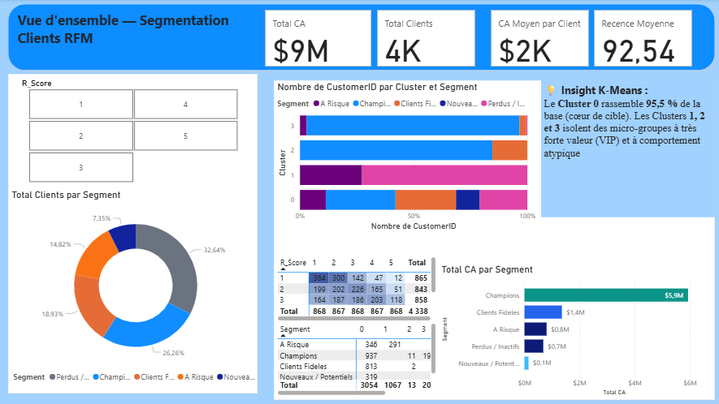

# 📊 Segmentation Client RFM & K-Means Pipeline


## 📌 Contexte & Objectifs

### 🎯 Contexte Métier

Dans le secteur du e-commerce, traiter l'ensemble des clients de la même manière mène à un manque d'efficacité marketing et à une perte de rétention. Pour optimiser les coûts d'acquisition et maximiser la valeur à vie du client (*Customer Lifetime Value*), il est essentiel de comprendre précisément la dynamique des achats.

Ce projet met en place une solution end-to-end permettant de transformer des données de transactions brutes en leviers d'action marketing concrets en combinant :

1. Une **segmentation métier (RFM)** basée sur des règles empiriques.
2. Un **clustering non surveillé (K-Means)** pour découvrir des comportements d'achat sous-jacents et isoler les profils atypiques.

### 🚀 Objectifs du Projet

* **Automatiser le traitement de données** : Construire un pipeline Python modulaire, robuste et reproductible de la donnée brute au dataset final.
* **Garantir la qualité des données** : Valider la structure et les types de données à chaque étape grâce à des contrats de schéma (**Pandera**).
* **Identifier les profils clients clés** : Structurer la base clients en segments actionnables (*Champions, Clients Fidèles, À Risque, etc.*).
* **Mettre à disposition un outil décisionnel** : Concevoir un tableau de bord **Power BI** interactif et intuitif pour les équipes marketing et la direction.

---

## 🛠️ Stack Technique

| Catégorie | Technologie / Bibliothèque | Usage principal |
| :--- | :--- | :--- |
| **Langage** | Python 3.10+ | Traitement des données et orchestration du pipeline |
| **Data Manipulation** | Pandas, NumPy | Nettoyage, agrégations et calcul des métriques RFM |
| **Machine Learning** | Scikit-Learn | Normalisation (`StandardScaler`) & Clustering (`KMeans`) |
| **Data Quality** | Pandera | Validation explicite des schémas de données entre chaque étape |
| **Business Intelligence** | Power BI, DAX | Dashboard interactif, modélisation en étoile et mesures DAX |
| **Environnement** | Git, GitHub | Versioning du code et documentation du projet |

---

## 💡 Défis Techniques & Solutions Apportées

* **Gestion des valeurs extrêmes (Outliers) dans le K-Means** : Les clients VIP à très fort panier moyen faussent souvent le clustering classique. L'utilisation d'une normalisation adaptée (`StandardScaler`) a permis d'isoler ces profils ultra-VIP dans des clusters dédiés (Clusters 1, 2, 3) tout en conservant un cluster principal homogène (Cluster 0).
* **Data Integrity & Robustesse du Pipeline** : Pour éviter toute casse lors du chargement dans Power BI, des schémas de validation **Pandera** vérifient la présence des colonnes, le non-nullité des identifiants (`CustomerID`) et les plages de valeurs autorisées (scores de 1 à 5).

---

## 🏗️ Architecture du Pipeline Python

Le traitement des données est entièrement automatisé sous forme d'un pipeline modulaire fiable, validé étape par étape grâce au framework **Pandera** :

* **1. Nettoyage (**`1_cleaning.py`**)** : Traitement des données d'achats (gestion des valeurs manquantes et suppression des anomalies).
* **2. Extraction RFM (**`2_raw_rfm.py`**)** : Calcul des métriques brutes (*Recency, Frequency, Monetary*).
* **3. Scoring (**`3_scores.py`**)** : Attribution des scores de 1 à 5 pour R, F et M.
* **4. Segmentation Métier (**`4_segments.py`**)** : Classification marketing (*Champions, Clients Fidèles, A Risque, Perdus/Inactifs, Nouveaux/Potentiels*).
* **5. Machine Learning (**`5_kmeans_clustering.py`**)** : Normalisation (`StandardScaler`) et clustering **K-Means**, avec validation finale du schéma de données.

## 📈 Dashboard Power BI & Insights Métier

Le fichier de sortie généré alimente un tableau de bord Power BI interactif croisant la segmentation par règles métier et l'approche Machine Learning.



### 💡 Insights Clés :

* **Performance Globale** : Analyse de **4 338 clients** générant un chiffre d'affaires total de **9 M$**.
* **Segment Champions** : Représente **26,26 %** de la base clients et génère la majeure partie du CA (**5,9 M$**).
* **Apport du Clustering K-Means** :
  * **Cluster 0** : Regroupe le cœur de cible (**95,5 %** des clients).
  * **Clusters 1, 2 et 3** : Isolent des micro-groupes à très forte valeur (**VIP**) et des comportements d'achat atypiques.

---

## 🛠️ Modélisation des Données (Power BI)

* **Table de faits** : `cleaned_data` (Transactions).
* **Table de dimensions** : `rfm_segmented` / `final_rfm_segments` (Profils clients, Scores RFM, Segments et Clusters).
* **Table dédiée DAX** : `_mesures` pour une gestion propre des KPIs (*Total CA, Total Clients, Recence Moyenne*).
* **Relation** : Liaison `1 à` * via la clé d'unicité `CustomerID`.

---

## 🚀 Installation & Exécution

### 1. Cloner le projet

```bash
git clone [https://github.com/votre-user/nom-du-repo.git](https://github.com/votre-user/nom-du-repo.git)
cd nom-du-repo
```

2. Installer les dépendances

```bash
pip install -r requirements.txt
```

3. Lancer le pipeline complet

```bash
python run_pipeline.py
```

---

```text
📂 Structure du Répertoire
├── data/
│   ├── raw/
│   └── processed/          # CSV nettoyés et prêts pour Power BI
├── power bi/
│   └── dash_2.png          # Capture d'écran du Dashboard Power BI
├── scripts/
│   ├── 1_cleaning.py
│   ├── 2_raw_rfm.py
│   ├── 3_scores.py
│   ├── 4_segments.py
│   └── 5_kmeans_clustering.py
├── run_pipeline.py         # Orchestrateur principal
├── dashboard.pbix          # Fichier Power BI
├── requirements.txt
└── README.md

---

---

---

## ✒️ Auteur

**Fouzia Bakrim** — Data Analyst

[](https://www.linkedin.com/in/fouzia-bakrim)